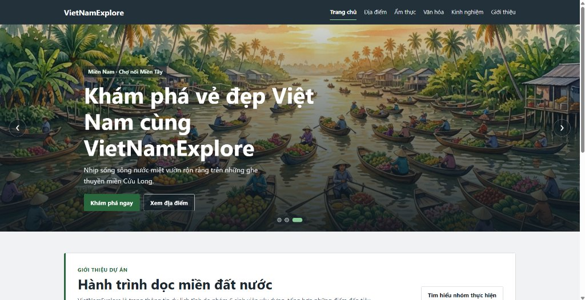
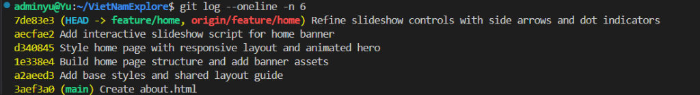

# Project Report — VietNamExplore (W07: Version Control with Git & GitHub)

## 1. Project Overview

### Project Description
**VietNamExplore** is a static travel website showcasing destinations, cuisine, cultural heritage, and travel tips across the three regions of Vietnam (North, Central, and South). The project was developed by a 6-member student team to practice version control and collaborative workflows using **Git & GitHub**.

The website consists of **06 interconnected HTML pages** built with semantic HTML5, CSS3, and vanilla JavaScript:
- `index.html` — **Home**: Features a 3-region watercolor hero slideshow, project introduction, and three highlighted content categories linking to all subpages.
- `destinations.html` — **Destinations**: Showcases notable travel spots across Vietnam with a JavaScript region filter (North – Central – South).
- `food.html` — **Cuisine**: Introduces signature regional dishes and local dining guides with an interactive region filter.
- `culture.html` — **Culture**: Highlights traditional festivals, clothing, and customs with expandable content sections.
- `tips.html` — **Travel Tips**: Provides practical advice on packing, budget, transportation, FAQs, and an interactive checklist.
- `about.html` — **About Us**: Introduces the 6 team members, project goals, and technologies used.

### Team Members
| No. | Full Name & Student ID | GitHub Account | Assigned Page & Responsibilities |
| :-: | :--- | :--- | :--- |
| 1 | `Nguyễn Nhật Thùy Khanh - 25127373` | `Yuru2812` (`Yu`) | Home page (`index.html`), shared layout & styles (`style.css`, `DESIGN_GUIDE.md`), Project Overview |
| 2 | `Đậu Cao Dũng - 25127301` | `DauCaoDung132` | Destinations page (`destinations.html`), initial repository setup, Branch & Merge Conflict tasks (Task 2, Task 4) |
| 3 | `Nguyễn Diệp Vĩnh Khang - 25127366` | `KhangNguyendotcpp` (`Khangnguyendotcpp`) | Cuisine page (`food.html`), Pull Request reviews & Merge Conflict resolution (Task 3, Task 4) |
| 4 | `Nguyễn Phi Bảo Bình - 25127020` | `npbbinh2511-arch` (`NGUYEN PHI BAO BINH`) | Culture page (`culture.html`), faulty navigation commit scenario (Task 5) |
| 5 | `Trương Cẩm Tú Nga - 25127427` | `tunnnga2605-png` | Travel Tips page (`tips.html`), `git revert` recovery & cross-page link testing (Task 5) |
| 6 | `Nguyễn Minh Huy - 25127062` | `nmhuy1211` (`Minh Huy`) | About Us page (`about.html`), `v1.0.0` release tag & GitHub Pages deployment (Task 6) |

### Project Links
- **GitHub Repository**: [https://github.com/DauCaoDung132/VietNamExplore](https://github.com/DauCaoDung132/VietNamExplore)
- **GitHub Pages (Published Website)**: [https://daucaodung132.github.io/VietNamExplore/](https://daucaodung132.github.io/VietNamExplore/) *(Thành viên 6 xác nhận lại đường dẫn sau khi hoàn tất Task 6 rồi xóa ghi chú này)*

---

## 2. Team Contributions

| Member | Assigned Tasks | Contributions | Evidence |
| :--- | :--- | :--- | :--- |
| **Nguyễn Nhật Thùy Khanh** (`Yuru2812` / `Yu`) | Task 1, Task 2, Task 3, Task 7 | Built the shared base stylesheet `assets/css/style.css` and layout documentation `docs/DESIGN_GUIDE.md`; created 3 watercolor banner illustrations and implemented the Home page (`index.html`, `assets/css/home.css`, `assets/js/home.js`) with an animated 3-slide carousel and responsive layout; initialized `docs/REPORT.md` and authored the Project Overview section. | Branch: [`feature/home`](https://github.com/DauCaoDung132/VietNamExplore/tree/feature/home) Commits: [`a2aeed3`](https://github.com/DauCaoDung132/VietNamExplore/commit/a2aeed33611537636908d3b9c328fb80d8834a91), [`1e338e4`](https://github.com/DauCaoDung132/VietNamExplore/commit/1e338e4c871ce925bad995d579e2666fc870c6e7), [`d340845`](https://github.com/DauCaoDung132/VietNamExplore/commit/d340845c3e1031a780f3146f8be5493511e69334), [`aecfae2`](https://github.com/DauCaoDung132/VietNamExplore/commit/aecfae29b7880ac53465b170d94534f42c16c596), [`7de83e3`](https://github.com/DauCaoDung132/VietNamExplore/commit/7de83e3e897bd3d9d61caa8ac3886d6a351134ae) PRs: [PR #2](https://github.com/DauCaoDung132/VietNamExplore/pull/2), [PR #3](https://github.com/DauCaoDung132/VietNamExplore/pull/3) |
| **Đậu Cao Dũng** (`DauCaoDung132`) | Task 1, Task 2, Task 3, Task 4, Task 7 | Initialized the GitHub repository, directory structure, `README.md`, `.gitignore`, and `CHANGELOG.md`; developed the Destinations page (`destinations.html`, `assets/css/destinations.css`, `assets/js/destinations.js`) with region filtering; co-created and resolved the merge conflict on `index.html`; documented Task 2 & Task 4. | Branch: `[Điền link branch]` Commits: `[Điền tối thiểu 3 link commits]` PR / Review: `[Điền link PR]` |
| **Nguyễn Diệp Vĩnh Khang** (`KhangNguyendotcpp` / `Khangnguyendotcpp`) | Task 1, Task 2, Task 3, Task 4, Task 7 | Developed the Cuisine page (`food.html`, `assets/css/food.css`, `assets/js/food.js`) featuring 6 regional dishes and interactive region filtering; participated in Pull Request reviews and merge conflict resolution; documented Task 3 & Task 4. | Branch: [`feature/food`](https://github.com/DauCaoDung132/VietNamExplore/tree/feature/food) Commits: [`0dec74f`](https://github.com/DauCaoDung132/VietNamExplore/commit/0dec74f4350361953ba46d4710a4e68ccaf6fb42), [`0fcc56a`](https://github.com/DauCaoDung132/VietNamExplore/commit/0fcc56a7398ed4eec35b7528f4be79e5167fce0e), [`521d862`](https://github.com/DauCaoDung132/VietNamExplore/commit/521d862578287fbd16b7d42af77e028d574078e5) PR: [PR #1](https://github.com/DauCaoDung132/VietNamExplore/pull/1) |
| **Nguyễn Phi Bảo Bình** (`npbbinh2511-arch` / `NGUYEN PHI BAO BINH`) | Task 1, Task 2, Task 3, Task 5, Task 7 | Developed the Culture page (`culture.html`, `assets/css/culture.css`, `assets/js/culture.js`) covering festivals, traditional attire, and customs with interactive toggles; introduced the intentional broken navigation link commit for Task 5; documented Task 5. | Branch: [`feature/culture`](https://github.com/DauCaoDung132/VietNamExplore/tree/feature/culture) Commits: [`b785236`](https://github.com/DauCaoDung132/VietNamExplore/commit/b7852364e34e891033cb8e41e4bb1eb47fc0fac8), [`4870437`](https://github.com/DauCaoDung132/VietNamExplore/commit/4870437167e8203e6dca54333a023dbc25466b1c), [`2bcc791`](https://github.com/DauCaoDung132/VietNamExplore/commit/2bcc791ac1858584e0f1a3ccf2cfda4102540e3c) PR: [PR #4](https://github.com/DauCaoDung132/VietNamExplore/pull/4) |
| **Trương Cẩm Tú Nga** (`tunnnga2605-png`) | Task 1, Task 2, Task 3, Task 5, Task 7 | Developed the Travel Tips page (`tips.html`, `assets/css/tips.css`, `assets/js/tips.js`) with an interactive packing checklist; identified the faulty navigation commit and reverted it using `git revert` (Task 5); verified navigation links across all 6 pages. | Branch: [`feature/tips`](https://github.com/DauCaoDung132/VietNamExplore/tree/feature/tips) Commits: [`bb92a39`](https://github.com/DauCaoDung132/VietNamExplore/commit/bb92a3951dfbc81acdf8cb358c80c0d3f5ec437c), [`c1981c6`](https://github.com/DauCaoDung132/VietNamExplore/commit/c1981c6e64d28ab72c355f445175e74f1ddb22d6), [`b3a583a`](https://github.com/DauCaoDung132/VietNamExplore/commit/b3a583aadcc01ed3765012b7aa7de7c459c34ef0) PR: [PR #5](https://github.com/DauCaoDung132/VietNamExplore/pull/5) |
| **Nguyễn Minh Huy** (`nmhuy1211` / `Minh Huy`) | Task 1, Task 2, Task 3, Task 6, Task 7 | Developed the About Us page (`about.html`, `assets/css/about.css`, `assets/js/about.js`); finalized `README.md` and `CHANGELOG.md`, created and pushed the `v1.0.0` release tag, deployed the site via GitHub Pages, and documented Task 6. | Branch: `[Điền link branch]` Commits: `[Điền tối thiểu 3 link commits]` PR / Release: `[Điền link PR & tag v1.0.0]` |

---

## 3. Implementation and Evidence

### Task 1. Setting Up the Repository and Managing Commits

- **Work completed**:
  - Created the `VietNamExplore` GitHub repository and initialized the project structure (`assets/css/`, `assets/js/`, `assets/images/`, `docs/images/`), core documentation files (`README.md`, `.gitignore`, `CHANGELOG.md`), and initial HTML files.
  - Established shared UI conventions in `assets/css/style.css` and `docs/DESIGN_GUIDE.md` so all team members could build consistent pages.
  - Configured individual Git identities (`git config user.name`, `git config user.email`) and practiced tracking changes with `git status`, `git add`, `git commit`, `git log`, `git diff`, `git show`, and `git push`, with each member making at least 3 meaningful commits.
- **Evidence**:
  - Core repository files: [`README.md`](../README.md), [`.gitignore`](../.gitignore), [`CHANGELOG.md`](../CHANGELOG.md), [`docs/DESIGN_GUIDE.md`](DESIGN_GUIDE.md).
  - Full repository commit log: [Commit History — VietNamExplore](https://github.com/DauCaoDung132/VietNamExplore/commits/main).
  - Terminal output showing commit history (`git log --oneline -n 6`):
    
- **Result**:
  - The repository is cleanly structured and ignores unnecessary OS/editor files via `.gitignore`. All 6 members contributed at least 3 meaningful commits each (exceeding the minimum 18 individual commits required for the team).

---

### Task 2. Working with Branches
*(Phụ trách tổng hợp: **Thành viên 2 — Đậu Cao Dũng**)*

- **Work completed**:
  - `[Thành viên 2 viết bằng tiếng Anh: Mô tả việc mỗi thành viên clone repo và phát triển trang của mình trên feature branch riêng (feature/home, feature/destinations, feature/food, feature/culture, feature/tips, feature/about), không code trực tiếp trên main.]`
- **Evidence**:
  - Active and merged branches on GitHub: [Branches — VietNamExplore](https://github.com/DauCaoDung132/VietNamExplore/branches).
  - `[Thành viên 2 liệt kê tên các feature branches của cả 6 thành viên và chèn ảnh chụp sơ đồ nhánh từ docs/images/...]`
- **Result**:
  - `[Thành viên 2 ghi kết quả bằng tiếng Anh: Nhóm tạo >= 6 feature branches độc lập, giữ nhánh main ổn định trong suốt quá trình phát triển.]`

---

### Task 3. Collaborating with Pull Requests
*(Phụ trách tổng hợp: **Thành viên 3 — Nguyễn Diệp Vĩnh Khang**)*

- **Work completed**:
  - `[Thành viên 3 viết bằng tiếng Anh: Mô tả quy trình mở Pull Request từ feature branch vào main kèm tiêu đề/mô tả rõ ràng, và quá trình các thành viên khác review code, để lại nhận xét trước khi merge.]`
- **Evidence**:
  - Pull Requests list on GitHub: [Pull Requests — VietNamExplore](https://github.com/DauCaoDung132/VietNamExplore/pulls?q=is%3Apr).
  - Pull Requests created by the team:
    - [PR #1 — Cuisine Page (`feature/food`)](https://github.com/DauCaoDung132/VietNamExplore/pull/1)
    - [PR #2 — Shared Base Styles & Layout Guide (`feature/home`)](https://github.com/DauCaoDung132/VietNamExplore/pull/2)
    - [PR #3 — Home Page & Interactive Slideshow (`feature/home`)](https://github.com/DauCaoDung132/VietNamExplore/pull/3)
    - [PR #4 — Culture Page (`feature/culture`)](https://github.com/DauCaoDung132/VietNamExplore/pull/4)
    - [PR #5 — Travel Tips Page (`feature/tips`)](https://github.com/DauCaoDung132/VietNamExplore/pull/5)
    - `[Thành viên 3 bổ sung thêm PR của TV2, TV6 và chèn ảnh chụp màn hình phần bình luận review trong docs/images/...]`
- **Result**:
  - `[Thành viên 3 ghi kết quả bằng tiếng Anh: Hoàn thành >= 4 merged Pull Requests với >= 3 PR được review; cả 6 thành viên đều tham gia tạo hoặc review PR bằng tài khoản cá nhân.]`

---

### Task 4. Resolving a Merge Conflict
*(Phụ trách thực hiện & tổng hợp: **Thành viên 2 & Thành viên 3**)*

- **Work completed**:
  - `[Thành viên 2 & 3 viết bằng tiếng Anh: Mô tả kịch bản tạo 2 nhánh feature/update-title-a và feature/update-title-b từ cùng một commit gốc, cùng sửa tiêu đề trong index.html khác nhau, merge nhánh A vào main rồi merge nhánh B để gây conflict và giải quyết conflict.]`
- **Evidence**:
  - `[Điền link 2 nhánh / PR gây conflict, commit giải quyết conflict và chèn ảnh chụp màn hình đoạn dấu <<<<<<< ======= >>>>>>> từ docs/images/...]`
- **Result**:
  - `[Ghi kết quả bằng tiếng Anh: Merge conflict được giải quyết thành công, trang index.html hoạt động ổn định và lịch sử Git ghi nhận đầy đủ quá trình merge.]`

---

### Task 5. Reverting a Commit
*(Phụ trách thực hiện & tổng hợp: **Thành viên 4 & Thành viên 5**)*

- **Work completed**:
  - `[Thành viên 4 & 5 viết bằng tiếng Anh: Mô tả việc Thành viên 4 tạo một commit cố ý làm sai liên kết điều hướng, sau đó Thành viên 5 tìm mã hash của commit lỗi và dùng lệnh git revert để hoàn tác.]`
- **Evidence**:
  - Faulty commit (broken navigation link): `[Điền mã hash & link commit lỗi của TV4]`
  - Revert commit (`git revert`): `[Điền mã hash & link commit revert của TV5]`
  - `[Chèn ảnh chụp màn hình kết quả kiểm thử liên kết 6 trang từ docs/images/...]`
- **Result**:
  - `[Ghi kết quả bằng tiếng Anh: Liên kết điều hướng được khôi phục chính xác trên cả 6 trang thông qua commit revert mà không viết lại lịch sử Git.]`

---

### Task 6. Preparing a Release and Deploying the Website
*(Phụ trách thực hiện & tổng hợp: **Thành viên 6 — Nguyễn Minh Huy**)*

- **Work completed**:
  - `[Thành viên 6 viết bằng tiếng Anh: Mô tả việc cập nhật thông tin cuối cùng vào README.md và CHANGELOG.md, tạo và push tag v1.0.0, triển khai website qua GitHub Pages và kiểm tra đường dẫn công khai.]`
- **Evidence**:
  - Release tag `v1.0.0`: [Tags — VietNamExplore](https://github.com/DauCaoDung132/VietNamExplore/tags)
  - Release changelog: [`CHANGELOG.md`](../CHANGELOG.md)
  - Published GitHub Pages URL: `[Điền link GitHub Pages hoạt động]`
  - `[Chèn ảnh chụp màn hình trang GitHub Pages và tag v1.0.0 từ docs/images/...]`
- **Result**:
  - `[Ghi kết quả bằng tiếng Anh: Bản phát hành v1.0.0 được gắn tag trên GitHub và website tĩnh hoạt động đầy đủ trên GitHub Pages.]`

---

### Task 7. Writing the Project Report
*(Thực hiện: **Cả nhóm 6 thành viên** — xóa dòng ghi chú này sau khi hoàn tất)*

- **Work completed**:
  - Initialized `docs/REPORT.md` with the project overview, team contribution table, and structured implementation sections for Tasks 1–7.
  - Each team member documented their individual tasks, commit links, Pull Request links, and supporting screenshots in `docs/images/`.
  - Added a direct link to `docs/REPORT.md` in the root `README.md` file.
- **Evidence**:
  - Markdown report on GitHub: [`docs/REPORT.md`](REPORT.md)
  - Supporting screenshots directory: [`docs/images/`](images/)
  - Report-related commits (`>= 3 commits`): `[Điền link các commits cập nhật docs/REPORT.md của nhóm]`
- **Result**:
  - A complete, concise Markdown report hosted directly on GitHub documenting all 7 tasks and verified contributions from all 6 team members.
