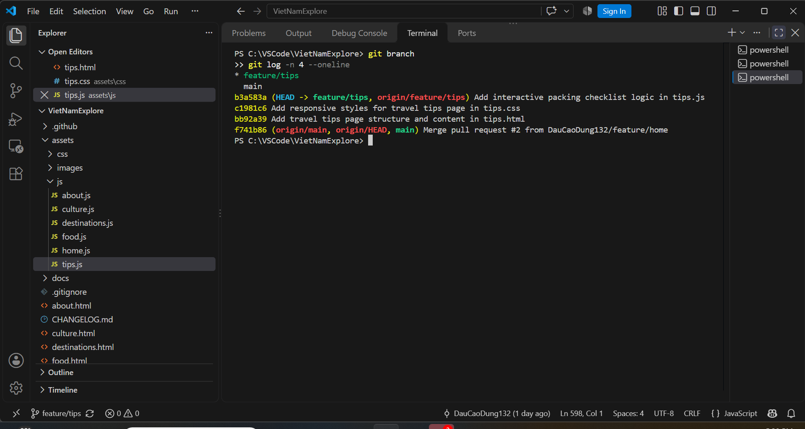
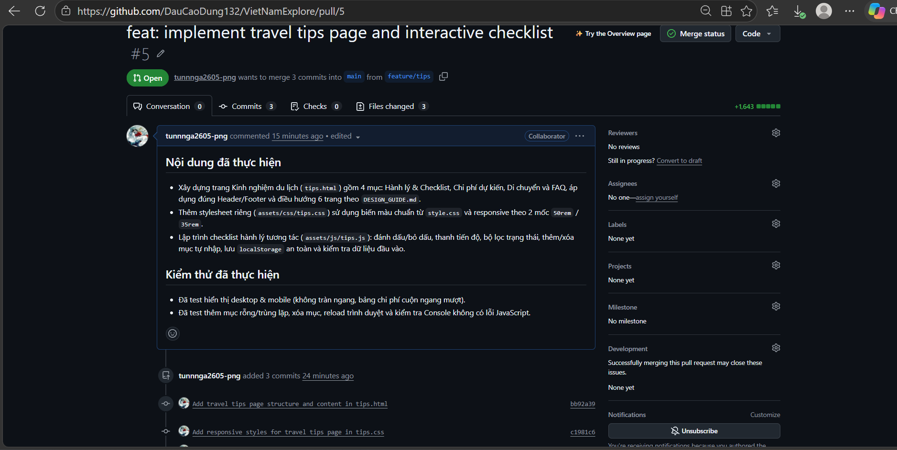
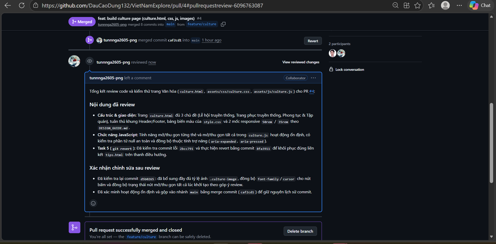
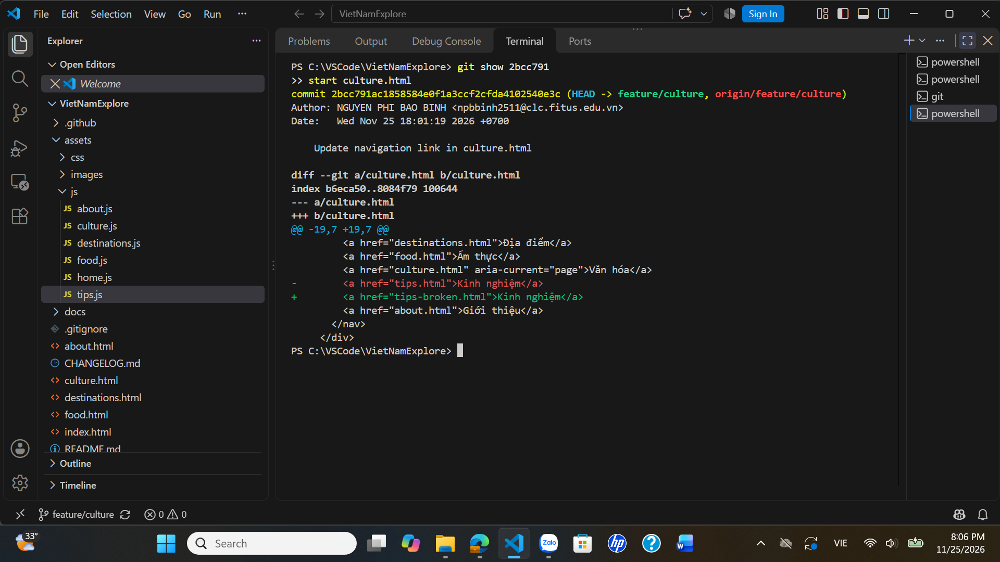
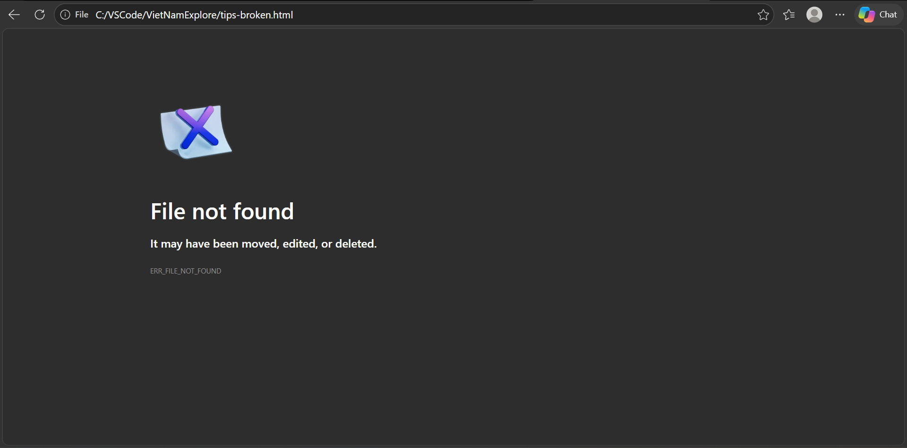
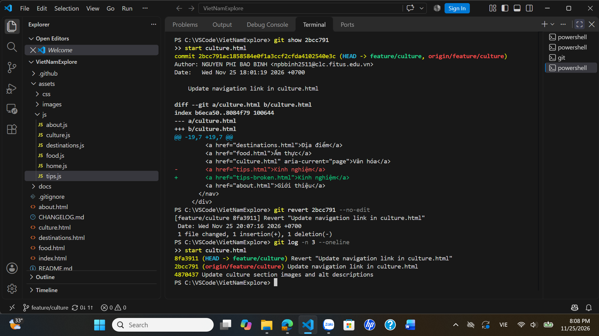
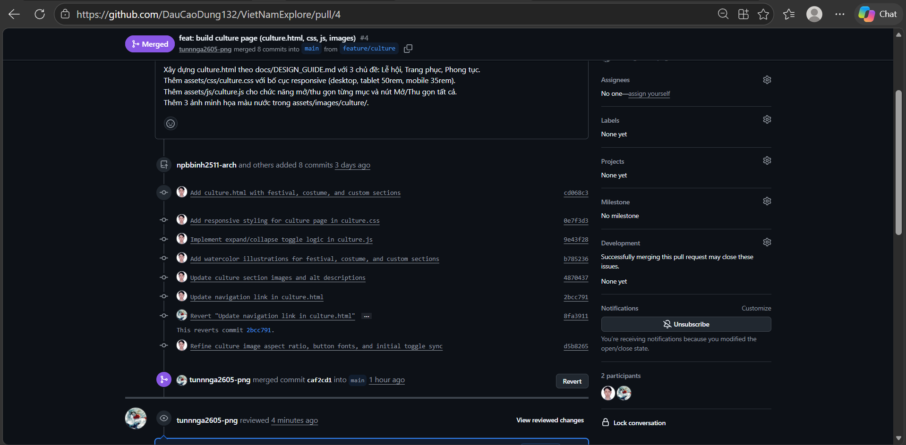

# Báo cáo dự án VietNamExplore — W07

> **Trạng thái bản nháp:** Danh sách thành viên đã được cập nhật theo thông tin nhóm cung cấp. Lịch sử Git, PR, tag, triển khai Pages và ảnh minh chứng vẫn cần xác nhận bằng bằng chứng thật trước khi nộp.

## Project Overview

VietNamExplore là website tĩnh giới thiệu du lịch Việt Nam, gồm sáu phần nội dung dự kiến: trang chủ, địa điểm, ẩm thực, văn hóa, kinh nghiệm và giới thiệu nhóm. Dự án dùng HTML, CSS, JavaScript cơ bản; mã nguồn được quản lý bằng Git/GitHub.

| Thông tin | Giá trị |
|---|---|
| Repository | [DauCaoDung132/VietNamExplore](https://github.com/DauCaoDung132/VietNamExplore) |
| GitHub Pages | Chưa xác nhận đã bật; URL dự kiến: `https://daucaodung132.github.io/VietNamExplore/` |
| Báo cáo | `docs/REPORT.md` |
| Ảnh minh chứng | `docs/images/` |

## Team Contributions

| Member | Assigned Tasks | Contributions | Evidence |
|---|---|---|---|
| **Nguyễn Nhật Thùy Khanh** (`Yuru2812`, 25127373) | Tasks 1, 2, 3, 7 | Home page, shared styles and design guide, project overview. | PRs [#2](https://github.com/DauCaoDung132/VietNamExplore/pull/2), [#3](https://github.com/DauCaoDung132/VietNamExplore/pull/3); add verified commit/review evidence. |
| **Đậu Cao Dũng** (`DauCaoDung132`, 25127301) | Tasks 1, 2, 3, 4, 7 | Repository setup, destinations page, branches and merge conflict. | Add branch, commit, PR and conflict evidence. |
| **Nguyễn Diệp Vĩnh Khang** (`KhangNguyendotcpp`, 25127366) | Tasks 1, 2, 3, 4, 7 | Cuisine page, PR review and merge conflict. | PR [#1](https://github.com/DauCaoDung132/VietNamExplore/pull/1); add verified review/conflict evidence. |
| **Nguyễn Phi Bảo Bình** (`npbbinh2511-arch`, 25127020) | Tasks 1, 2, 3, 5, 7 | Culture page and coordination on the revert exercise. | PR [#4](https://github.com/DauCaoDung132/VietNamExplore/pull/4); add verified commit/revert evidence. |
| **Trương Cẩm Tú Nga** (`tunnnga2605-png`, 25127427) | Tasks 1, 2, 3, 5, 7 | Xây dựng trang Kinh nghiệm du lịch (`tips.html`, `assets/css/tips.css`, `assets/js/tips.js`, 4 ảnh minh họa trong `assets/images/tips/`); review code PR #4; thực hiện `git revert` khôi phục liên kết lỗi cho Task 5; kiểm thử chức năng và liên kết. | Branch [`feature/tips`](https://github.com/DauCaoDung132/VietNamExplore/tree/feature/tips); PR [#5](https://github.com/DauCaoDung132/VietNamExplore/pull/5) (commits `bb92a39`, `c1981c6`, `b3a583a`); review PR [#4](https://github.com/DauCaoDung132/VietNamExplore/pull/4); revert commit [`8fa3911`](https://github.com/DauCaoDung132/VietNamExplore/commit/8fa3911). |
| **Nguyễn Minh Huy** (`nmhuy1211`, 25127062) | Tasks 1, 2, 3, 6, 7 | About page, release preparation, and Task 6 report/demo materials. | Branch [`feature/introduction`](https://github.com/DauCaoDung132/VietNamExplore/tree/feature/introduction); open PR [#6](https://github.com/DauCaoDung132/VietNamExplore/pull/6). Add verified review and release evidence when available. |

## Implementation and Evidence

### Task 1 — Repository và commit

- Kết quả/bằng chứng: nhóm bổ sung link repository, danh sách commit và cấu hình Git identity thực tế.
- **Thành viên 5 — Trương Cẩm Tú Nga (`tunnnga2605-png`):** Đã cấu hình Git identity cá nhân, clone repository và thực hiện các meaningful commits xây dựng trang `tips.html` (`bb92a39`), `assets/css/tips.css` (`c1981c6`), `assets/js/tips.js` (`b3a583a`) cùng các commit bổ sung ảnh minh họa theo góp ý review.

### Task 2 — Branches

- Kết quả/bằng chứng: nhóm bổ sung danh sách feature branch và commit tương ứng của từng thành viên.
- **Thành viên 5 (`feature/tips`):** Phát triển toàn bộ trang Kinh nghiệm du lịch độc lập trên nhánh [`feature/tips`](https://github.com/DauCaoDung132/VietNamExplore/tree/feature/tips) tách từ `main`.
  

### Task 3 — Pull Request và review
- Kết quả/bằng chứng: nhóm bổ sung link PR đã merge, người review và nhận xét review cụ thể.
- **Thành viên 5 — Trương Cẩm Tú Nga (`tunnnga2605-png`):**
  - Tạo [PR #5](https://github.com/DauCaoDung132/VietNamExplore/pull/5) (`feature/tips` → `main`) có tiêu đề, mô tả triển khai và tiếp thu góp ý reviewer để bổ sung 4 ảnh minh họa cho trang `tips.html`.
  - Tham gia review code và xác nhận gộp [PR #4](https://github.com/DauCaoDung132/VietNamExplore/pull/4) (`culture.html`, `assets/css/culture.css`, `assets/js/culture.js`) vào nhánh `main` bằng merge commit [`caf2cd1`](https://github.com/DauCaoDung132/VietNamExplore/commit/caf2cd1).
  
  

### Task 4 — Merge conflict

- Kết quả/bằng chứng: nhóm bổ sung link/commit conflict, người tham gia và ảnh giải quyết conflict trong `docs/images/`.

### Task 5 — Git revert
*(Responsible members: **Member 4 — Nguyễn Phi Bảo Bình** & **Member 5 — Trương Cẩm Tú Nga**)*

- **Work completed**:
  - **Tạo commit gây lỗi (Thành viên 4 — `npbbinh2511-arch`):** Trên nhánh [`feature/culture`](https://github.com/DauCaoDung132/VietNamExplore/tree/feature/culture) thuộc [PR #4](https://github.com/DauCaoDung132/VietNamExplore/pull/4), cố ý sửa liên kết điều hướng tại dòng 22 của `culture.html` từ `href="tips.html"` sang `href="tips-broken.html"` (commit `2bcc791`).
  - **Xác định lỗi và hoàn tác (Thành viên 5 — `tunnnga2605-png`):** Chuyển sang nhánh `feature/culture`, dùng `git show 2bcc791` kiểm tra chính xác diff gây lỗi, mở `culture.html` tái hiện lỗi `ERR_FILE_NOT_FOUND` khi bấm mục **Kinh nghiệm**, sau đó chạy lệnh `git revert 2bcc791 --no-edit` để tạo commit hoàn tác an toàn `8fa3911` mà không ghi đè hay xóa lịch sử Git, rồi push lên GitHub.
  - **Xác minh sau hoàn tác:** Kiểm tra lại bằng `git log -n 3 --oneline` và bấm lại mục **Kinh nghiệm** trên `culture.html` để xác nhận liên kết đã trỏ lại đúng `tips.html`.
- **Evidence**:
  - Pull Request thực hành: [PR #4 — feat: build culture page](https://github.com/DauCaoDung132/VietNamExplore/pull/4)
  - Faulty commit (Thành viên 4): [`2bcc791`](https://github.com/DauCaoDung132/VietNamExplore/commit/2bcc791ac1858584e0f1a3ccf2cfda4102540e3c) — *Update navigation link in culture.html*
  - Revert commit (Thành viên 5): [`8fa3911`](https://github.com/DauCaoDung132/VietNamExplore/commit/8fa3911) — *Revert "Update navigation link in culture.html"*
  - Ảnh kiểm tra commit lỗi (`git show 2bcc791`):
    
  - Ảnh trình duyệt báo lỗi trước khi revert (`tips-broken.html` — `ERR_FILE_NOT_FOUND`):
    
  - Ảnh thực thi lệnh `git revert` và lịch sử `git log`:
    
  - Ảnh lịch sử commit trên GitHub PR #4 ghi nhận đủ cả commit lỗi và commit hoàn tác:
    
- **Result**:
  - Liên kết điều hướng mục **Kinh nghiệm** trong `culture.html` đã được khôi phục về `tips.html`, không còn lỗi `ERR_FILE_NOT_FOUND`.
  - Lịch sử Git giữ nguyên vẹn cả commit gây lỗi (`2bcc791`) lẫn commit hoàn tác (`8fa3911`) từ hai tài khoản GitHub khác nhau theo đúng yêu cầu Task 5.

### Task 6. Preparing a Release and Deploying the Website
*(Responsible member: **Member 6 — Nguyễn Minh Huy**)*

- **Work completed**:
  - Implemented `about.html`, `assets/css/about.css`, and `assets/js/about.js` with six member profiles, project/technology introduction, responsive layout, an interactive route map, and member-detail dialog with keyboard navigation.
  - Updated `README.md` and `CHANGELOG.md`; added `tools/check_links.py` and the release/demo slides at `docs/RELEASE_DEMO.html`.
  - Improved dialog accessibility by preserving focus when navigation reaches a disabled boundary button; non-HTML files in the dialog are shown as code labels rather than links.
- **Evidence**:
  - Feature branch and open PR: [`feature/introduction`](https://github.com/DauCaoDung132/VietNamExplore/tree/feature/introduction), [PR #6](https://github.com/DauCaoDung132/VietNamExplore/pull/6).
  - Local checks: `node --check assets/js/about.js` and `git diff --check`.
  - Browser check: focus remains inside the dialog at both navigation boundaries, Escape closes it, and only the HTML file is a link; CSS/JS files render as code.
  - Screenshots for desktop/mobile and the open dialog still need to be added to `docs/images/`.
- **Release status / remaining work**:
  - PR #6 is open; the release has not been completed. Do not claim `v1.0.0` or GitHub Pages as published until the tag and deployment are verified.
  - `python tools/check_links.py` currently fails with 8 errors because `index.html`, `destinations.html`, `culture.html`, and `tips.html` are still empty and lack navigation links.
  - Run the checker again after those pages are complete. Add the public URL and remote check result after GitHub Pages is live.
  - The team should complete the report evidence for Tasks 1–5 and add verified commit, review, tag, deployment, and screenshot evidence before submission.

### Task 7 — Báo cáo Markdown

- Báo cáo đặt tại `docs/REPORT.md`; nhóm cần cập nhật bằng chứng của Tasks 1–6, kiểm tra lại nội dung và lưu ảnh vào `docs/images/`.

## Kết quả cuối cùng

Chưa thể xác nhận các chỉ tiêu nghiệm thu khi thiếu trạng thái GitHub và bằng chứng nhóm. Hoàn tất các ô sau bằng số liệu/URL thật trước khi nộp:

| Chỉ tiêu | Yêu cầu | Kết quả thực tế | Bằng chứng |
|---|---:|---|---|
| Trang HTML có nội dung và điều hướng | Tối thiểu 5 | Chưa xác minh | Link từng trang |
| Commit cá nhân | 3/người; tối thiểu 18 tổng | Chưa xác minh | Lịch sử commit |
| Feature branch | Tối thiểu 6 | Chưa xác minh | Danh sách branch |
| PR đã merge / có review | Tối thiểu 4 / 3 | Chưa xác minh | Danh sách PR và review |
| Cả 6 người tham gia PR | 6/6 | Chưa xác minh | PR theo thành viên |
| Conflict / revert | Có, đủ người tham gia | Chưa xác minh | Commit và ảnh |
| Tag `v1.0.0` / GitHub Pages | Đã push / hoạt động | Chưa xác minh | Tag và URL Pages |
| Commit liên quan báo cáo | Tối thiểu 3 | Chưa xác minh | Lịch sử commit |

## Kiểm thử

Sau khi các trang còn lại được hoàn thiện, chạy:

```bash
python tools/check_links.py
python tools/check_links.py --base https://daucaodung132.github.io/VietNamExplore/
```

Chỉ ghi “đạt” khi lệnh trả mã thoát 0, các trang hoạt động và ảnh/bằng chứng tương ứng đã được lưu.
